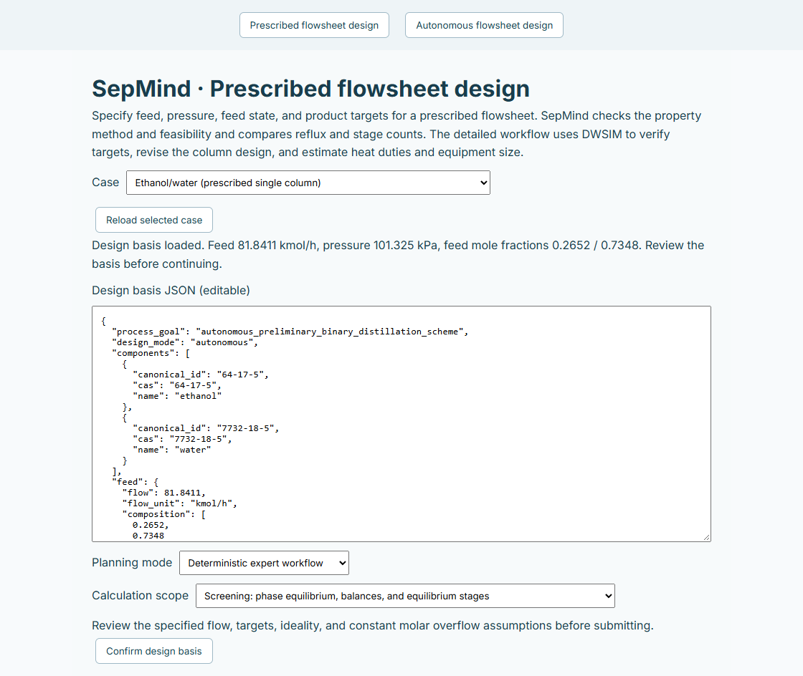
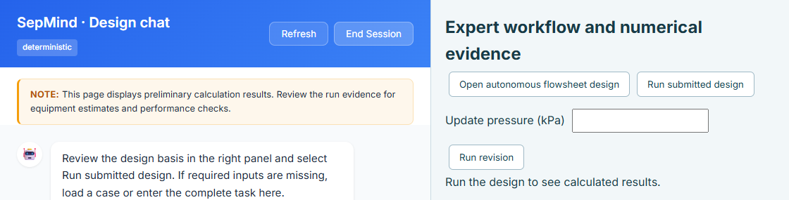
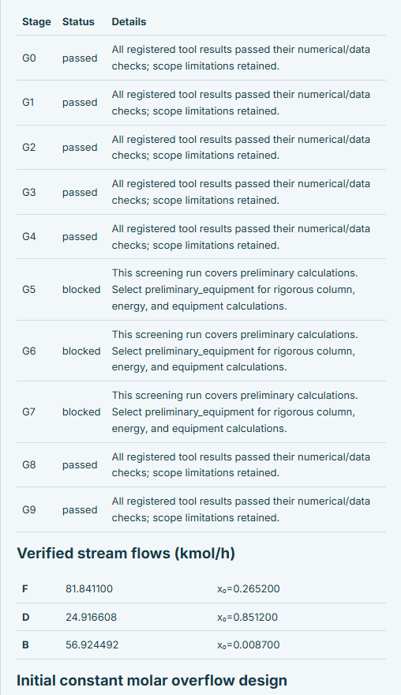
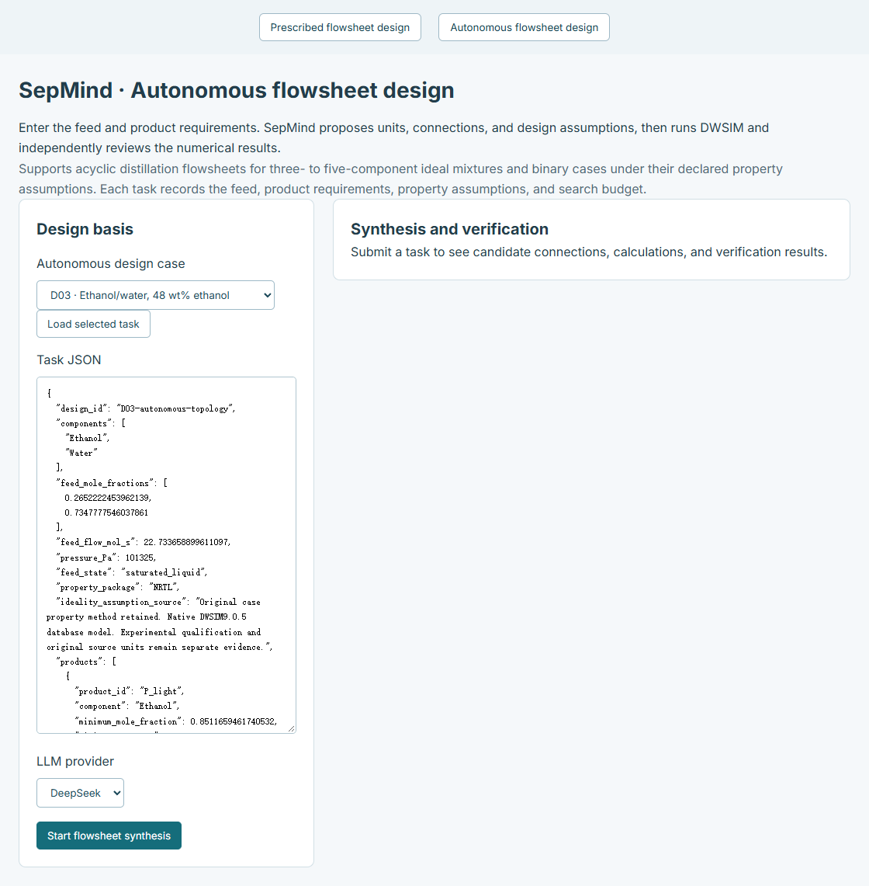
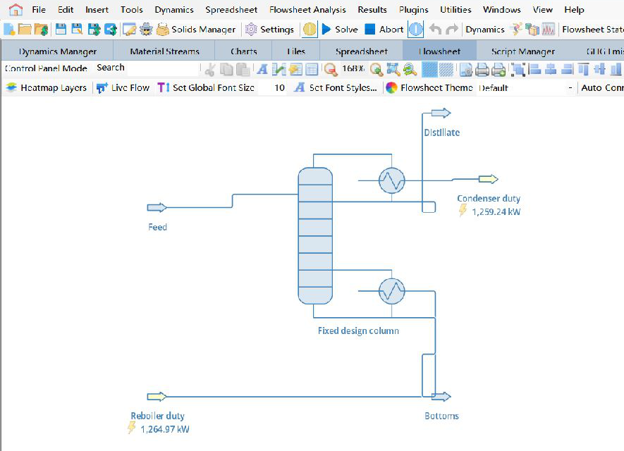
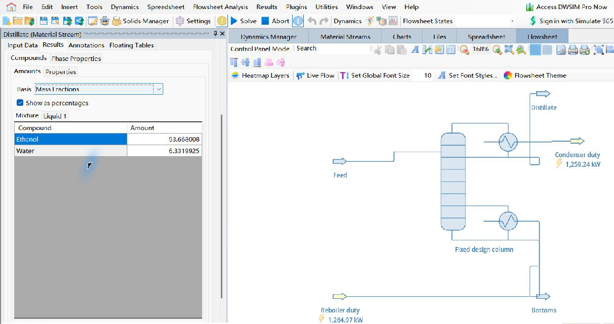

# SepMind

SepMind implements the expert-guided agent framework described in *Expert-guided agent framework for chemical separation process design*. It translates expert reasoning and design procedures into executable workflows that connect thermodynamic model selection, process calculations, independent numerical verification, and targeted design revision.

Expert knowledge is represented through versioned runtime Skills, property-model cards, and numerical tool contracts that constrain permitted decisions, stage dependencies, and design acceptance. Independent checks evaluate thermodynamic consistency, material and energy balances, and product specifications. Failed checks guide targeted revisions while preserving the original design requirements and triggering recalculation of affected results.

SepMind was developed on the basis of Google Health's Personal Health Agent (PHA). [Upstream project](https://github.com/Google-Health/consumer-health-research/tree/3e9d1e4877a54cf81ce8ef34085006952dd19601/personal_health_agent)

The study covers four industrial distillation design cases (D01–D04) and two source-defined integrated processes (H01 and H02).

| Design setting | Input | Decisions made by SepMind |
| --- | --- | --- |
| **Setting I — Prescribed flowsheet design** | Feed, separation requirements, and a specified flowsheet | Design and operating parameters within the given topology, including equilibrium stages, feed stage, and reflux ratio where adjustable |
| **Setting II — Autonomous flowsheet design** | Feed, separation requirements, and an empty flowsheet | Number of units, stream connections, and design parameters within the registered unit models |

## Reproduce the paper results

Run these commands from the repository root with Python 3.11 or later. They use the standard library and the [archived numerical records](reproducibility/evidence.json).

```text
python -m reproducibility verify
python -m reproducibility export --output reproduced/tables
python -m unittest reproducibility.test_tables
```

The export produces CSV files for Tables 1–3, Tables S4–S11, the ethanol/water decision trace, and the supplementary comparisons. Table 2 includes the recorded Setting I metrics. The Setting II architecture-comparison cells are blank. Four individually verified autonomous designs are available in `autonomous_flowsheet_examples.csv`. The [reproduction guide](reproducibility/README.md) maps each result to its source and documents the evaluation boundaries.

## Run a design calculation

Install the [research dependencies](requirements-research.txt). The documented simulator workflow was tested with Python 3.13 and Windows DWSIM 9.0.5. Use a fresh output directory for each run.

```text
python -m pip install -r requirements-research.txt
```

**Prescribed flowsheet design.** This deterministic D01 example runs the equilibrium and column-screening workflow using the case input. The resulting state lists the executed checks and their scope.

```text
python -m reproducibility design --setting I --case D01 --provider deterministic --output output/setting-I-D01
```

**Autonomous flowsheet design.** Inspect the empty-topology task, then run the design with DeepSeek and DWSIM configured. Set `DEEPSEEK_API_KEY` in the local environment and `DWSIM_HOME` to the directory containing `DWSIM.Automation.dll`.

```text
python -m reproducibility design --setting II --case D01 --basis-only
python -m reproducibility design --setting II --case D01 --output output/setting-II-D01
```

**Replay a rigorous column.** With DWSIM configured, replay a recorded design using its archived request. The command needs no LLM credentials. It saves the request, native flowsheet, numerical result, and comparison with the recorded product compositions.

```text
python -m reproducibility replay-column --case D01 --design sepmind --output reproduced/D01
```

## Web portal tutorial

### Start the portal

From the repository root, start the API in one terminal.

```text
python -m pip install -r requirements-research.txt
python -X utf8 -m uvicorn api.main:app --host 127.0.0.1 --port 8000
```

In a second terminal, start the web interface.

```text
cd frontend
npm ci
npm run dev -- --host 127.0.0.1
```

Open the local address printed in the frontend terminal, typically [http://127.0.0.1:3000/](http://127.0.0.1:3000/).

### Setting I — Run the ethanol/water screening example

1. Select **Prescribed flowsheet design** and use the preloaded **Ethanol/water (prescribed single column)** case. Review the feed, pressure, and product targets in **Design basis JSON**. Select **Deterministic expert workflow** for **Planning mode** and **Screening: phase equilibrium, balances, and equilibrium stages** for **Calculation scope**. Click **Confirm design basis**.

   

2. On the design chat page, click **Run submitted design** at the top of the right panel.

   

   Scroll the right panel to **Workflow stage status** and the calculated stream flows, equilibrium stages, and reflux comparison. In the screening run shown below, G4 passes and G5–G7 are outside the selected scope.

   

3. Scroll down to **Export run results** to download JSON, CSV, or the Markdown report. To compare operating pressures, enter the new pressure in **Update pressure (kPa)** and click **Run revision**.

For rigorous column verification, energy balances, and preliminary equipment estimates, select the **Detailed** calculation scope before confirming the design basis. On Windows, set `DWSIM_HOME` to the DWSIM 9.0.5 installation directory containing `DWSIM.Automation.dll` before launching the API. For DeepSeek planning, set `DEEPSEEK_API_KEY` in the API environment.

### Setting II — Synthesize a flowsheet

Select **Autonomous flowsheet design** on the homepage or **Open autonomous flowsheet design** in the design chat. Choose a case, click **Load selected task**, and review the feed, product targets, property assumptions, and search budget in **Task JSON**. Configure the selected LLM provider and DWSIM on the API server, then click **Start flowsheet synthesis**. The right panel shows candidate flowsheets, numerical checks, and verification status as the run progresses.



### Inspect the D03 simulation in DWSIM

To reproduce the archived SepMind ethanol/water column, configure `DWSIM_HOME` as described above and run this command from the repository root.

```text
python -m reproducibility replay-column --case D03 --design sepmind --output reproduced/D03-sepmind
```

In DWSIM 9.0.5, open `reproduced/D03-sepmind/column.dwxmz` and select **Flowsheet**. The rigorous NRTL simulation gives a condenser duty of 1,259.24 kW and a reboiler duty of 1,264.97 kW.



Open the **Distillate** stream and select **Results → Compounds → Amounts**. Set **Basis** to **Mass Fractions** and enable **Show as percentages**. The distillate contains 93.6680 wt% ethanol. The same view for **Bottoms** gives 2.0422 wt% ethanol.



## Repository guide

| Path | Research material |
| --- | --- |
| [`sepmind/engineering/agents/`](sepmind/engineering/agents/) | Expert-guided orchestrator, thermodynamics expert, engineering calculation expert, and process design advisor |
| [`sepmind/engineering/workflow/`](sepmind/engineering/workflow/) | Stage dependencies, design revisions, and affected-result invalidation |
| [`sepmind/engineering/validation/`](sepmind/engineering/validation/) | Independent numerical checks and design acceptance |
| [`sepmind/engineering/topology/`](sepmind/engineering/topology/) | Autonomous flowsheet proposals, graph validation, unit execution, and flowsheet review |
| [`sepmind/simulation/`](sepmind/simulation/) | Shared DWSIM requests, calculation adapters, and isolated numerical worker |
| [`sepmind/agent_runtime/`](sepmind/agent_runtime/), [`sepmind/llm/`](sepmind/llm/) | Shared agent infrastructure and model-provider interfaces |
| [`sepmind/shortcut/`](sepmind/shortcut/) | Binary shortcut screening via `python -m sepmind.shortcut` |
| [Runtime Skills](engineering/runtime_skills/), [model cards](engineering/knowledge/), [tool contracts](engineering/contracts/) | Rules, parameter evidence, and numerical interfaces |
| [`case/curated/`](case/curated/) | Case inputs and English worked calculations from the human designs |
| [`experiments/sepmind_controls/`](experiments/sepmind_controls/) | Prescribed flowsheet architecture comparison and mechanism ablations on D01–D04 |
| [`reproducibility/`](reproducibility/) | Research entry point, archived evidence, CSV export, and rigorous-column replay |
| [Web portal tutorial](#web-portal-tutorial) | Startup and browser walkthrough for both design settings |

The cases are preliminary designs evaluated under the reported thermodynamic assumptions and numerical boundaries. H01 and H02 reconstruct source-defined flowsheets and evaluate controlled operating revisions. The reported balances and equipment estimates refer to those numerical boundaries.
