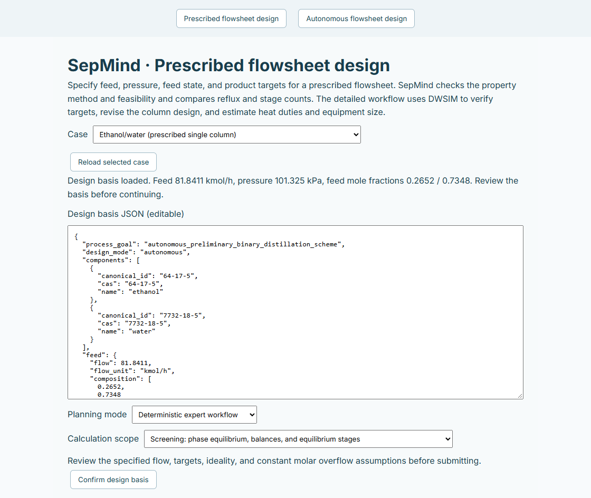
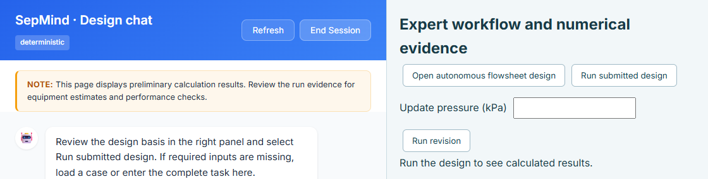
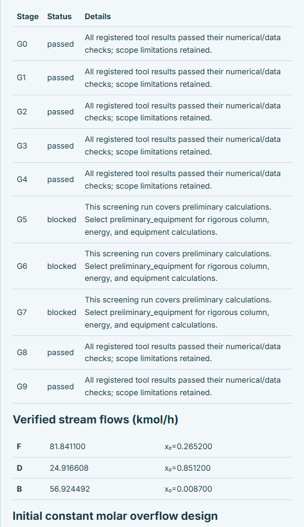
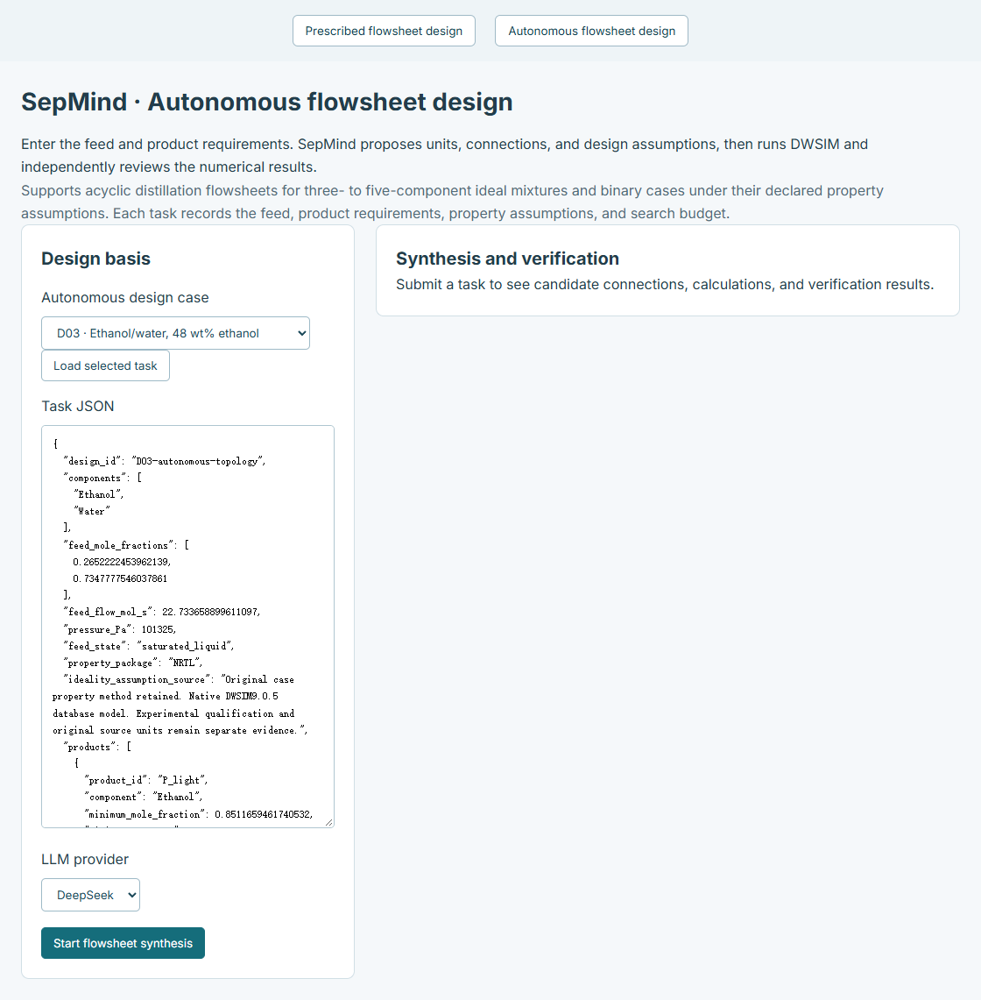
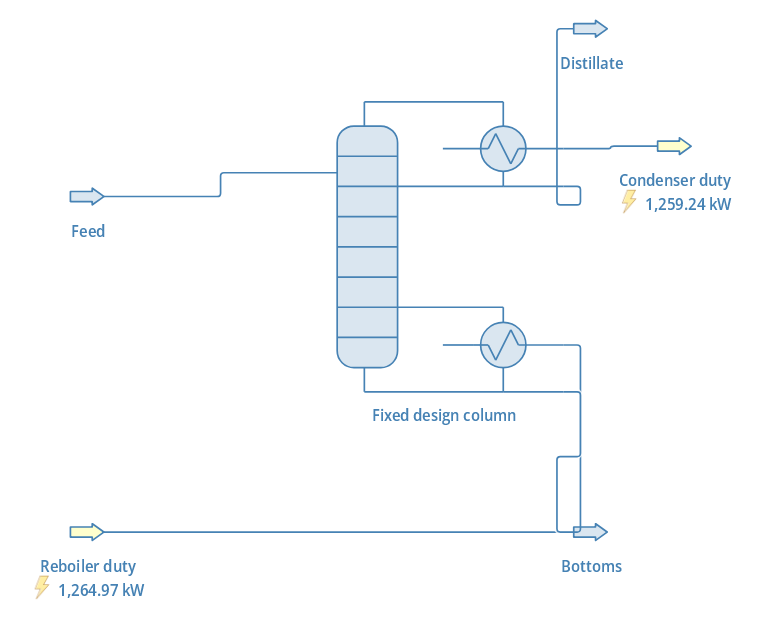
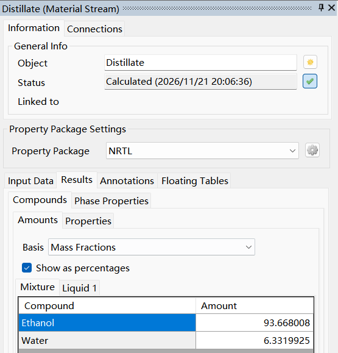

# SepMind web portal and DWSIM guide

This guide shows how to run SepMind in a browser, export design results, and replay the archived D03 ethanol/water column in DWSIM. For the paper's experiments and command-line examples, see the [reproduction guide](../../reproducibility/README.md).

## Start the portal

From the repository root, start the API in one terminal.

```text
python -m pip install -r requirements-research.txt
python -X utf8 -m uvicorn api.main:app --host 127.0.0.1 --port 8000
```

In a second terminal, start the web interface.

```text
cd frontend
npm ci
npm run dev -- --host 127.0.0.1
```

Open the local address printed in the frontend terminal, typically [http://127.0.0.1:3000/](http://127.0.0.1:3000/).

## Setting I — Run the ethanol/water screening example

1. Select **Prescribed flowsheet design** and use the preloaded **Ethanol/water (prescribed single column)** case. Review the feed, pressure, and product targets in **Design basis JSON**. Select **Deterministic expert workflow** for **Planning mode** and **Screening: phase equilibrium, balances, and equilibrium stages** for **Calculation scope**. Click **Confirm design basis**.

   

2. On the design chat page, click **Run submitted design** at the top of the right panel.

   

   Scroll the right panel to **Workflow stage status** and the calculated stream flows, equilibrium stages, and reflux comparison. In the screening run shown below, G4 passes and G5–G7 are outside the selected scope.

   

3. Scroll down to **Export run results** to download JSON, CSV, or the Markdown report. To compare operating pressures, enter the new pressure in **Update pressure (kPa)** and click **Run revision**.

For rigorous column verification, energy balances, and preliminary equipment estimates, select the **Detailed** calculation scope before confirming the design basis. On Windows, set `DWSIM_HOME` to the DWSIM 9.0.5 installation directory containing `DWSIM.Automation.dll` before launching the API. For DeepSeek planning, set `DEEPSEEK_API_KEY` in the API environment.

## Setting II — Synthesize a flowsheet

Select **Autonomous flowsheet design** on the homepage or **Open autonomous flowsheet design** in the design chat. Choose a case, click **Load selected task**, and review the feed, product targets, property assumptions, and search budget in **Task JSON**. Configure the selected LLM provider and DWSIM on the API server, then click **Start flowsheet synthesis**. The right panel shows candidate flowsheets, numerical checks, and verification status as the run progresses.



## Inspect the D03 simulation in DWSIM

Install the [research dependencies](../../requirements-research.txt) and set `DWSIM_HOME` to the Windows DWSIM 9.0.5 installation directory containing `DWSIM.Automation.dll`. From the repository root, run the following command with a fresh output directory. The archived replay uses no LLM credentials.

```text
python -m reproducibility replay-column --case D03 --design sepmind --output reproduced/D03-sepmind
```

The replay saves the native flowsheet and a comparison with the archived product compositions. In DWSIM 9.0.5, open `reproduced/D03-sepmind/column.dwxmz` and select **Flowsheet**. The rigorous NRTL simulation gives a condenser duty of 1,259.24 kW and a reboiler duty of 1,264.97 kW.



Open the **Distillate** stream and select **Results → Compounds → Amounts**. Set **Basis** to **Mass Fractions** and enable **Show as percentages**. The distillate contains 93.6680 wt% ethanol. The same view for **Bottoms** gives 2.0422 wt% ethanol.


